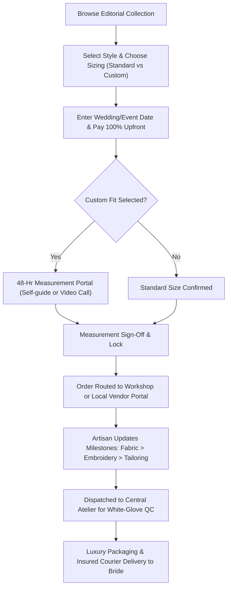

# Business Requirement Document (BRD)
## Luxury Women's Wedding Wear E-Commerce Platform

> **Status:** Specification Complete  
> **Segment:** Luxury Wedding Wear & Bespoke Bridal Couture  
> **Business Model:** Hybrid (Private Label + Curated Local Vendors + Made-to-Order)  
> **Payment Policy:** 100% Upfront  
> **Return Policy:** Final Sale (Bespoke / Made-to-Order)

---

## 1. Executive Summary & Vision
* **Project Working Title:** *Luxe Bridal Atelier*
* **Mission:** An elite digital bridal salon delivering bespoke, handcrafted luxury wedding couture to brides and festive shoppers worldwide.
* **Core Value Proposition:** Seamlessly merging the exclusivity of haute couture with digital ease—featuring flexible measurement submission, curated local artisan craftsmanship, and total production transparency.

---

## 2. Business Model & Operating Rules
* **Category:** Luxury Bridal, Festive Occasionwear, Trousseau & Cocktail Ensembles.
* **Supply Model:** Hybrid:
  * **In-House Private Label:** Signature master atelier creations.
  * **Partner Artisan Vendors:** Curated local master weavers, embroiderers, and boutique workshops.
* **Payment Terms:** **100% Upfront Payment** at checkout to fund raw material procurement and reserve artisan production capacity.
* **Return & Exchange Policy:** **Strict Final Sale** on all made-to-order and custom-sized garments. Mandatory customer acknowledgment required before checkout.

---

## 3. Customer Sizing & Measurement Flow (Option C: Flexible Model)
* **Dual Choice on Product Page:**
  1. **Standard Sizing (XS–3XL):** With generous 2–3 inch internal alteration margins.
  2. **Custom Bespoke Fit:** Allows ordering immediately without having measurements on hand.
* **48-Hour Measurement Grace Window:**
  * When *"Custom Bespoke Fit"* is chosen, the customer pays 100% upfront to reserve the production slot.
  * A dedicated **Measurement Concierge Link** is sent via WhatsApp and Email.
  * The customer has **48 hours** to submit their measurements via an illustrated self-guided form or book a 10-minute virtual tailor assistance call.
  * *Contingency Rule:* If measurements are not received within 48 hours, automated reminders trigger, and the estimated delivery date shifts day-for-day.

---

## 4. End-to-End User Journey

---

## 5. Functional Requirements (MoSCoW Matrix)

### A. Customer Storefront
* **Must Have (MVP):**
  * **Luxury Editorial PDP:** 4K texture zoom (zardozi, threadwork, silks), 360° video runway reel, fabric details, lining specs.
  * **Flexible Sizing Selector:** Standard size selector vs. *"Custom Made-to-Measure"* option.
  * **Event Date Selector:** Mandatory field at checkout to guarantee timely delivery buffers.
  * **Mandatory Final Sale Acknowledgment:** Explicit checkbox and modal confirmation before payment.
  * **Interactive Measurement Studio:** Visual anatomical guide with input fields for 8 key measurements (Bust, Under-bust, Waist, Hips, Shoulder, Armhole, Blouse length, Height with heels).
  * **Customer Order & Production Milestone Tracker:** Visual status bar showing progress from *Fabric Sourced* to *Embroidered*, *Tailored*, *QC Passed*, and *Shipped*.

### B. Self-Service Vendor Portal (Local Artisans & Workshops)
* **Must Have (MVP):**
  * **Vendor Authentication & Dashboard:** Role-based login for each approved local vendor partner.
  * **Order Assignment Feed:** Filtered list of orders allocated to the vendor, tagged with production deadlines and wedding dates.
  * **Downloadable Production Tech-Packs:** 1-click printable PDF spec sheets containing exact customer measurements, design references, and fabric notes.
  * **Milestone Update Pipeline:** One-click status triggers:
    1. *Order Accepted & Sourcing Started*
    2. *Hand Embroidery in Progress*
    3. *Tailoring & Assembly*
    4. *Ready for Dispatch to Central Hub*
  * **Dispatch to Central Hub Tracking:** Vendor logs courier tracking code or internal dispatch note when shipping the raw piece to the central brand hub.

### C. Central Admin & Quality Control (QC) Hub
* **Must Have (MVP):**
  * **Order Allocation Engine:** Route incoming orders to either In-House Atelier or specific local vendor.
  * **Measurement Audit Queue:** Alerts if customer measurements have mathematical discrepancies (e.g., disproportionate shoulder-to-bust ratio) before routing to artisans.
  * **Central QC Inbound Station:** Barcode/order scan upon receiving the garment from the local vendor.
  * **Digital QC Sign-Off Checklist:** 5-point verification (Measurement check with tape, stitch tension, embellishment security, stain check, weight check) with photo archive.
  * **White-Glove Packaging & Courier Dispatch:** Generates insured shipping labels (DHL/FedEx/Bluedart) with automated customer tracking alerts.

---

## 6. Technical Stack & Security Architecture
* **Frontend:** Next.js (React) / Tailwind CSS for ultra-fast, luxury editorial rendering.
* **Backend / OMS:** Modular E-Commerce API (e.g., MedusaJS or Shopify Plus Custom App) with custom PostgreSQL database for measurement schemas and vendor portals.
* **Storage:** Cloudinary / AWS S3 for high-res lookbooks and vendor QC proof images.
* **Notifications:** Twilio / WhatsApp Business API + SendGrid for automated 48-hour measurement reminders and milestone alerts.
* **Payment Processing:** Stripe / Razorpay (with 3D Secure, fraud shield, and multi-currency conversion).

---

## 7. Risk Management & Compliance
* **Chargeback & Dispute Protection:** Clear audit trail storing customer's submitted measurements, checked "Final Sale" consent timestamp, and pre-shipping QC inspection photos.
* **Delivery Buffer Policy:** Built-in safety margin of 10 business days before the customer's stated wedding date.
