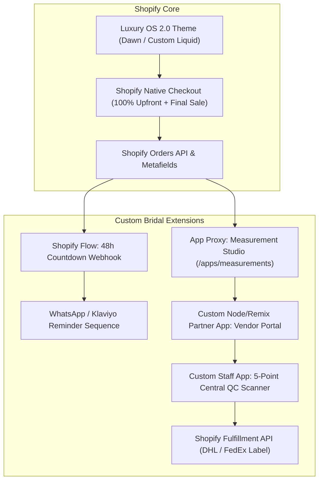

# Phase-by-Phase Implementation Plan (Shopify Architecture)
## Luxe Bridal Atelier — Shopify E-Commerce & Custom Artisan Ecosystem

> **Platform:** Shopify (Online Store 2.0 + Shopify Checkout Extensibility + Custom Artisan App)  
> **Target Outcome:** Production-ready Luxury Bridal Store on Shopify with 48-Hour Measurement Grace Period, Vendor Portal, and Central QC.  
> **Timeline:** 10 Weeks (Shopify out-of-the-box checkout & hosting accelerates delivery by 4 weeks!)

---

## 🏗️ Shopify Architectural Blueprint

---

## 🗺️ Phase-by-Phase Roadmap

### Phase 0: Shopify Store Setup & Data Modeling
* **Duration:** Weeks 1–2 (Sprint 1)
* **Theme:** Store configuration, Shopify Partner App scaffolding, and Metafield definitions.

#### Key Deliverables:
1. **Store & Currency Setup:**
   * Shopify store initialized with Shopify Payments (3D Secure, multi-currency support: USD, INR, GBP, EUR).
   * Brand aesthetics: Typography, color palette, luxury transactional email templates.
2. **Metafields & Metaobjects Architecture:**
   * **Product Metafields:** `craftsmanship.hours`, `craftsmanship.artisan_guild`, `craftsmanship.fabrics`, `craftsmanship.lead_time_weeks`.
   * **Order Metafields:** `bridal.event_date`, `bridal.sizing_mode` (`STANDARD` vs `BESPOKE`), `bridal.measurement_status` (`PENDING`, `SUBMITTED`, `VERIFIED`), `bridal.assigned_vendor_id`.
   * **Measurement Metaobject:** Stores 8 anatomical measurements linked to Order ID.
3. **Custom Shopify Partner App Scaffolding:**
   * Node.js / Remix / Prisma app using `@shopify/shopify-app-remix` to power the Vendor Portal and Measurement App Proxy.
* **Exit Criteria (DoD):** Shopify store live in staging; Metafields and custom app connected via Shopify CLI.

---

### Phase 1: Luxury Storefront Theme & Event Date Engine
* **Duration:** Weeks 3–4 (Sprint 2)
* **Theme:** OS 2.0 theme customization, interactive sizing switcher, and event buffer calculations.

#### Key Deliverables:
1. **Custom Liquid Editorial Product Template (`product.bridal.liquid`):**
   * Multi-angle high-resolution gallery with zoom lens and 360° video embed blocks.
   * Provenance & artisan storytelling section powered by product metafields.
2. **Line Item Properties & Sizing Switcher:**
   * Custom UI block toggling **Standard Sizing (XS–3XL)** vs. **Custom Bespoke (48-Hr Grace)**.
   * Captures selection as Shopify Line Item Property (`properties['_SizingMode']`).
3. **Event Date Picker with Dynamic Buffer Calculation:**
   * Front-end date picker checking days until wedding:
     * `< 28 Days`: Triggers rush fee variant or blocks checkout.
     * `28–44 Days`: Displays tight-timeline priority notice.
     * `≥ 45 Days`: Displays comfortable buffer badge.
   * Stores value into order attributes (`attributes['WeddingDate']`).
4. **Checkout Extensibility & Final Sale Consent:**
   * Shopify Checkout rules enforcing the **Final Sale Consent Checkbox** before payment can be processed.
* **Exit Criteria (DoD):** Customer can choose sizing mode, input wedding date, accept final sale terms, and complete a 100% upfront purchase.

---

### Phase 2: Bespoke Measurement Studio (Shopify App Proxy)
* **Duration:** Weeks 5–6 (Sprint 3)
* **Theme:** Client measurement submission and Shopify Flow automation.

#### Key Deliverables:
1. **App Proxy Studio (`/apps/measurements`):**
   * Embedded web page served inside Shopify store theme.
   * Secure token authentication sent to customer upon order placement.
   * 8-metric anatomical measurement form with illustrated guide and ratio checks.
   * Updates Order Metafields directly via Shopify Admin API upon submission.
2. **Video Consultation Booking Block:**
   * Calendly / Google Meet embed for 1-on-1 stylist appointments.
3. **Shopify Flow Automated 48-Hour Sequence:**
   * **Trigger:** `Order Created` with `properties['_SizingMode'] == 'Custom Bespoke'`.
   * **Actions:**
     * Sends immediate email/WhatsApp with direct measurement link.
     * Wait 24 Hours ➔ Check if `bridal.measurement_status == 'PENDING'` ➔ Send reminder nudge.
     * Wait 16 Hours ➔ Send urgent reminder (*"8 hours remaining"*).
     * If unresolved at 48 Hours ➔ Add order tag `Measurement Delayed`, adjust fulfillment target date.
* **Exit Criteria (DoD):** Measurement studio updates order metafields; automated Shopify Flow reminders fire reliably.

---

### Phase 3: Self-Service Artisan Vendor Portal
* **Duration:** Weeks 7–8 (Sprint 4)
* **Theme:** Vendor portal app, 1-click tech-packs, and production tracking.

#### Key Deliverables:
1. **Artisan Partner Login Portal:**
   * Standalone portal powered by our Custom Shopify App with vendor-scoped authentication.
   * Filtered view displaying only orders assigned to that specific vendor (`vendor_id`).
   * Displays customer event dates and internal delivery deadlines.
2. **1-Click PDF Tech-Pack Generator:**
   * Generates printable PDF containing product design sketches, fabric requirements, and customer's exact 8 measurements extracted from Order Metafields.
3. **Milestone Progress Buttons:**
   * Vendor clicks to advance production stage:
     * `Fabric Sourced & Cut`
     * `Hand Embroidery in Progress`
     * `Tailoring Complete`
     * `Dispatched to Central Hub` (captures internal tracking/delivery note).
   * Automatically updates Shopify Order Tags & Timeline.
* **Exit Criteria (DoD):** Artisan can log into portal, download PDF tech-pack, and update milestones that reflect inside Shopify Admin.

---

### Phase 4: Central Atelier QC Hub & Carrier Fulfillment
* **Duration:** Weeks 9–10 (Sprint 5)
* **Theme:** Inbound inspection, white-glove packaging, and carrier integration.

#### Key Deliverables:
1. **Central Staff QC Scanner (Shopify Admin Extension):**
   * Barcode/QR scanner interface for warehouse/atelier intake.
   * Digital 5-Point Inspection Checklist:
     1. Tape-measure check against submitted measurements (Tolerance: ±0.5").
     2. Zardozi & embroidery tension check.
     3. Lining and internal seam margins (+3" verified).
     4. Daylight stain & odor inspection.
     5. Fabric drape and weight verification.
   * Uploads 2 inspection photos directly to Order Metafield file attachments.
2. **Shopify Fulfillment & Shipping Label Generation:**
   * QC pass automatically triggers fulfillment via DHL Express / FedEx / Bluedart shipping app.
   * Customer receives standard Shopify shipping notification with tracking URL.
3. **UAT & Launch Preparation:**
   * End-to-end simulated test orders from storefront checkout to vendor completion and QC fulfillment.
* **Exit Criteria (DoD):** Full operational cycle verified; ready for public store launch.
