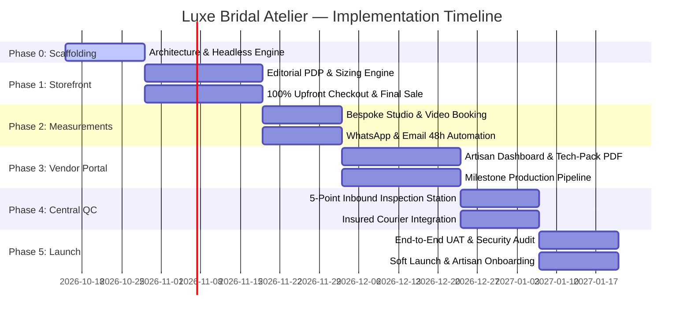

# Phase-by-Phase Implementation Plan
## Luxe Bridal Atelier — E-Commerce & Artisan Platform

> **Plan Horizon:** 14 Weeks (7 Two-Week Sprints)  
> **Target Outcome:** Production-ready MVP Launch with Storefront, Measurement Studio, Vendor Portal, and Central QC Hub.

---

## 🗺️ Roadmap Overview

---

## Phase 0: Foundation, Architecture & Headless Engine
* **Duration:** Weeks 1–2 (Sprint 1)
* **Theme:** Infrastructure setup, data schemas, and developer tooling.

### Key Deliverables:
1. **Frontend Scaffolding:**
   * Next.js (React 19) App Router project initialized with TypeScript and Tailwind CSS.
   * Luxury design system setup (Cormorant Garamond editorial fonts, champagne gold palette, responsive layout primitives).
2. **Backend & Headless Commerce Setup:**
   * Medusa.js v2 (or custom Node.js/Fastify microservices) connected to a managed PostgreSQL database.
   * Database schema migrations:
     * `User` (Client, Vendor, QC Inspector, Admin)
     * `Order` (Status, WeddingDate, SizingMode, FinalSaleConsent, 100% Upfront flag)
     * `MeasurementRecord` (8 anatomical metrics, submission timestamps)
     * `Vendor` (Workshop profile, capacity, assigned SKUs)
     * `QCInspection` (Checklist criteria, photo URLs, sign-off status)
3. **Cloud Infrastructure & Media Pipeline:**
   * Cloudinary / AWS S3 bucket with image transformation presets (WebP/AVIF, progressive lazy-loading).
* **Exit Criteria (DoD):** Database schemas deployed, auth scaffolding operational, CI/CD pipeline building cleanly.

---

## Phase 1: Customer Storefront & High-Touch PDP
* **Duration:** Weeks 3–5 (Sprints 2–3)
* **Theme:** Client visual discovery, sizing flexibility, and upfront checkout.

### Key Deliverables:
1. **Editorial PDP & Media Showcase:**
   * Interactive gallery with 4K hover-magnification lens and 360° runway video drape preview.
   * Craftsmanship metadata module (*Artisan provenance, handcrafting hours, fabric origin*).
2. **Dynamic Event Date Buffer Engine:**
   * Interactive wedding date selector validating against real-time production schedules:
     * ≥ 45 Days: Comfortable buffer badge.
     * 28–44 Days: Expedited production schedule alert.
     * < 28 Days: Automatic 15% rush surcharge applied or order blocked based on capacity.
3. **Sizing Selector (Standard vs. Custom Bespoke):**
   * Standard sizing grid (XS–3XL) with internal seam margin indicators.
   * Custom Bespoke selector activating the 48-Hour Flexible Sizing Guarantee.
4. **100% Upfront Checkout & Legal Final Sale Protection:**
   * Stripe / Razorpay integration with 3D Secure 2.0.
   * Mandatory Final Sale checkbox logging customer consent timestamp, IP, and user agent.
   * Order confirmation view with active 48-hour countdown clock.
* **Exit Criteria (DoD):** Successful end-to-end order placement with payment captured and wedding date safety buffer enforced.

---

## Phase 2: Bespoke Measurement Studio & Client Concierge
* **Duration:** Weeks 6–7 (Sprint 4)
* **Theme:** Stress-free post-purchase measurement collection and automated reminders.

### Key Deliverables:
1. **Interactive Self-Guided Measurement Studio:**
   * Responsive web view capturing 8 core metrics (Bust, Underbust, Waist, Hips, Shoulder, Armhole, Blouse length, Lehenga length with heels).
   * Anatomical visual guide highlighting exact tape-measure placement.
   * Math validation engine detecting unnatural anatomical ratios before submission.
2. **Virtual Stylist Video Appointment Integration:**
   * 1-click booking integration (Calendly / Google Meet / Zoom API) for brides requesting guided assistance.
3. **Automated 48-Hour Notification Pipeline:**
   * Webhook-triggered WhatsApp Business API & SendGrid notification sequence:
     * **T+0h:** Immediate post-order confirmation & direct measurement link.
     * **T+24h:** Gentle reminder with hours remaining.
     * **T+40h:** Urgent reminder (*"8 hours left to preserve original delivery timeline"*).
     * **T+48h:** Status update shifting target delivery date day-for-day until received.
* **Exit Criteria (DoD):** Clients can submit measurements independently or book stylist calls; automated notifications trigger on schedule.

---

## Phase 3: Self-Service Artisan Vendor Portal
* **Duration:** Weeks 8–10 (Sprints 5–6)
* **Theme:** Digitizing local workshop operations and order handoff.

### Key Deliverables:
1. **Vendor Authentication & Workspace Dashboard:**
   * Role-based vendor login isolating assigned orders by workshop ID.
   * Urgency-sorted queue tagged with client wedding dates and internal delivery milestones.
2. **Standardized 1-Click Tech-Pack Generator:**
   * Serverless PDF engine generating printable artisan spec sheets:
     * Technical garment sketch and SKU details.
     * Exact verified client measurements.
     * Fabric, lining, and embroidery material specifications.
3. **Milestone Production Pipeline:**
   * One-touch status updates with timestamped audit logging:
     1. `Sourcing & Fabric Cut`
     2. `Hand Embroidery In Progress`
     3. `Tailoring & Assembly Complete`
     4. `Dispatched to Central Atelier` (with tracking number / courier note).
* **Exit Criteria (DoD):** Vendor receives order alert, downloads PDF tech-pack, updates milestone status, and dispatches item to central atelier.

---

## Phase 4: Central Atelier QC Hub & Insured Logistics
* **Duration:** Weeks 11–12 (Sprint 7)
* **Theme:** Quality assurance, white-glove packaging, and insured customer delivery.

### Key Deliverables:
1. **Inbound QC Station:**
   * Barcode/QR scan on arrival pulling original client tech-pack onto tablet UI.
   * Digital 5-Point Verification Checklist:
     1. Physical tape-measure check against submitted specs (Tolerance: ±0.5 inches).
     2. Embellishment / Zardozi tension and seam integrity.
     3. Lining and internal seam margin check.
     4. Daylight lamp stain and odor inspection.
     5. Fabric weight and drape check.
   * Mandatory upload of 2 high-resolution inspection photos before QC sign-off.
2. **White-Glove Packaging & Carrier Logistics:**
   * Automated label generation via DHL Express / FedEx / Bluedart shipping APIs with declared transit insurance.
   * Automated dispatch notification with real-time tracking link sent to the bride.
3. **Client Milestone Tracking Portal:**
   * Customer-facing visual journey tracker (*Order Placed ➔ Measurements Verified ➔ Handcrafted ➔ QC Passed ➔ Dispatched*).
* **Exit Criteria (DoD):** Completed garments scanned, verified via 5-point checklist, photographed, and shipping labels generated automatically.

---

## Phase 5: UAT, Security Audits & Soft Launch
* **Duration:** Weeks 13–14 (Sprint 8)
* **Theme:** Production hardening, pilot testing, and public rollout.

### Key Deliverables:
1. **End-to-End Simulation Testing:**
   * Place test orders across edge cases (rush orders, measurement submitted at hour 47, measurement delayed beyond 48 hours).
2. **Security & Chargeback Hardening:**
   * Verify immutable logging of "Final Sale" checkbox agreement (IP, user agent, timestamp) for merchant defense.
   * Conduct PCI-DSS compliance checks and vulnerability scan.
3. **Pilot Vendor Onboarding:**
   * Onboard initial 3 local master workshops with hands-on portal walkthroughs.
4. **Soft Launch:**
   * Deploy to production domain with curated limited-edition bridal collection.
* **Exit Criteria (DoD):** Zero critical bugs, 100% test pass rate on payment and notifications, successfully processed pilot orders.
