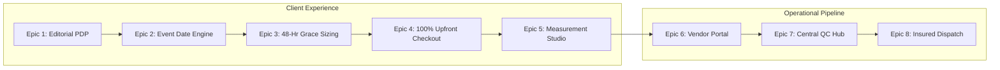
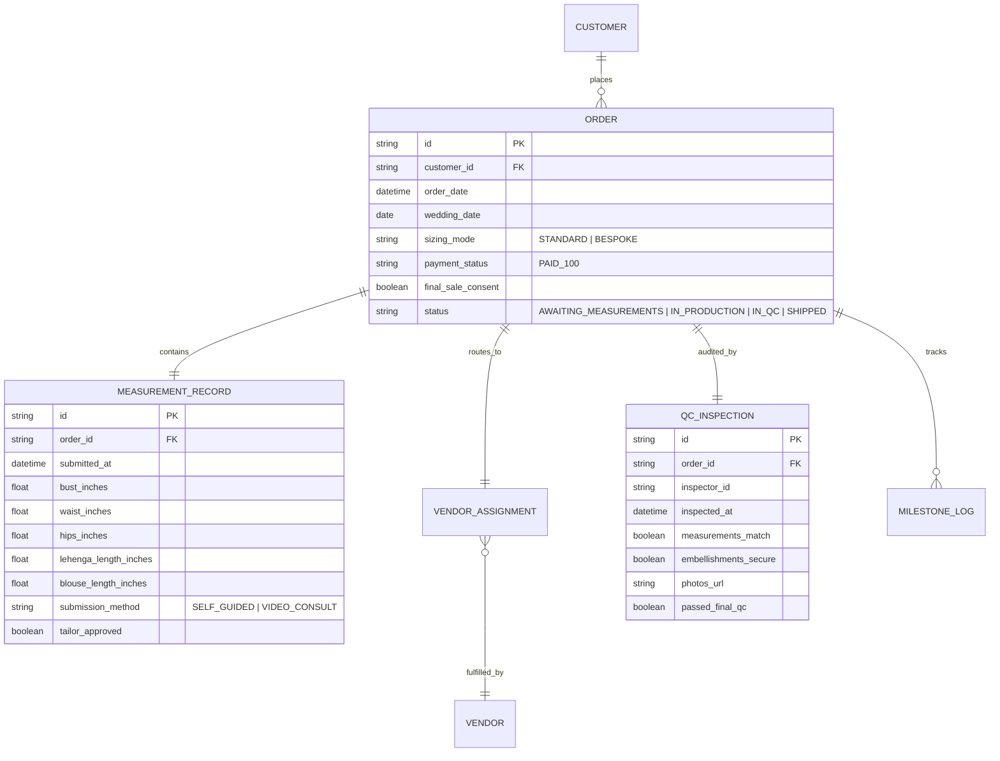

# Product Requirement Document (PRD)
## Project: Luxe Bridal Atelier — E-Commerce & Artisan Platform

> **Document Status:** Complete  
> **Version:** 1.0.0  
> **Target Release:** MVP v1.0  
> **Author:** Ashwika Agarwal / Antigravity

---

## 1. Document Overview & Objectives

### 1.1 Executive Summary
Luxe Bridal Atelier is a high-touch, digital-first luxury bridal boutique combining in-house private-label couture with curated local artisan workshops. The platform features made-to-order garments, flexible post-purchase measurement submissions (48-hour grace window), a self-service artisan vendor portal, and a centralized quality control (QC) inspection hub.

### 1.2 Core Product Goals
1. **Eliminate Sizing Friction:** Increase bridal conversion by enabling customers to reserve high-demand production slots immediately without needing measurements on hand.
2. **Prevent Delivery Disasters:** Enforce event-date buffering to ensure 100% of bridal garments arrive at least 10 business days before the wedding date.
3. **Streamline Artisan Operations:** Digitize the local workshop workflow with self-service order assignment and downloadable measurement tech-packs.
4. **Protect Working Capital:** Enforce 100% upfront payment and legally binding Final Sale acknowledgment to mitigate custom couture risk.

---

## 2. Success Metrics & Telemetry (KPIs)

| Metric Category | Key Performance Indicator (KPI) | Target Benchmark |
| :--- | :--- | :--- |
| **Conversion** | PDP to Checkout Completion Rate | > 1.8% (Luxury fashion benchmark) |
| **Sizing Adoption** | % of Orders choosing 48-Hour Flexible Measurement | > 65% of custom orders |
| **Compliance** | Measurement Submission Rate within 48h Window | > 92% |
| **Operations** | On-Time Delivery Buffer (Arrived ≥ 10 days pre-event) | 99.5% |
| **Quality** | Post-delivery Alteration Discrepancy Rate | < 2.5% |

---

## 3. User Personas & Permissions Matrix

### 3.1 Personas
* **Bride / Client (Consumer):** High expectations of luxury, seeks reassurance on fabric quality, timeline safety, and tailored fit.
* **Master Artisan / Vendor (External Partner):** Skilled craftsperson/workshop manager; needs straightforward mobile-friendly order sheets, measurement specs, and milestone updating.
* **Atelier QC Lead (Internal Admin):** Inspects physical garments against customer measurement specs before luxury packaging and courier dispatch.
* **Brand Merchandiser / Admin (Internal):** Manages collections, assigns production capacity to workshops, and monitors delivery health.

---

## 4. Feature Epics & Detailed User Stories

---

### Epic 1: Luxury Editorial Storefront & PDP
* **User Story 1.1:** As a bride, I want to view multi-angle 4K images and 360° runway drape videos so that I can inspect the intricacy of the hand embroidery, fabric sheen, and silhouette.
  * **Acceptance Criteria:**
    * PDP must feature an interactive gallery supporting minimum 4 high-res photos and video reel preview.
    * Hover-to-zoom lens must render 2x magnification with zero layout shift.
    * Displays artisan provenance badge (*e.g., "280 Artisan Hours • Varanasi Master Guild"*).

---

### Epic 2: Wedding / Event Date Buffer Engine
* **User Story 2.1:** As a bride, I must enter my event date at checkout so that the boutique guarantees my outfit is delivered well in advance.
  * **Acceptance Criteria:**
    * Event Date is a mandatory input before order reservation.
    * **Buffer Rules:**
      * **Comfortable Buffer:** Event date ≥ 45 days away → Displays green confirmation badge (*Guaranteed dispatch 10 days before event*).
      * **Tight Buffer:** 28–44 days away → Displays amber alert with expedited production schedule.
      * **Rush Order:** < 28 days away → System triggers a 15% rush fee surcharge and requires admin capacity verification.

---

### Epic 3: Dual Sizing Architecture & 48-Hour Grace Period
* **User Story 3.1:** As a customer, I want to choose between standard sizes or custom made-to-measure without delaying my order placement.
  * **Acceptance Criteria:**
    * Mode A (Standard): XS to 3XL with explicit note: *"+3 inches internal seam allowance included"*.
    * Mode B (Custom Bespoke): Locks production slot instantly upon payment.
    * Activates a 48-hour countdown timer on the user's order dashboard and sends direct WhatsApp/Email measurement links.

---

### Epic 4: 100% Upfront Checkout & Final Sale Agreement
* **User Story 4.1:** As the business owner, I require 100% payment upfront and binding consent to protect bespoke manufacturing costs.
  * **Acceptance Criteria:**
    * Checkout button remains disabled until the customer actively checks: *"I understand this is a bespoke made-to-order couture piece and is strictly Final Sale."*
    * Order confirmation PDF and email record timestamped consent for dispute protection.

---

### Epic 5: Interactive Measurement Studio
* **User Story 5.1:** As a bride who chose Custom Bespoke, I want an intuitive self-guided tool or video call option to submit my measurements accurately.
  * **Acceptance Criteria:**
    * Form captures 8 essential metrics: Bust, Underbust, Natural Waist, High Hips, Shoulder Width, Armhole, Blouse Length, and Waist-to-Floor (with heels).
    * Integrated anatomical diagram highlighting where to measure.
    * Option to 1-click book a 10-minute video measurement session via Google Meet / Calendly.
    * **Contingency Rule:** If measurements are not submitted within 48 hours, system triggers WhatsApp reminder at T+24h, T+36h, and T+44h. After T+48h, the delivery date dynamically adjusts +1 day for each day delayed.

---

### Epic 6: Self-Service Artisan Vendor Portal
* **User Story 6.1:** As an external artisan partner, I want a secure portal to see orders assigned to my workshop and download customer measurement spec sheets.
  * **Acceptance Criteria:**
    * Role-based login isolating orders by vendor ID.
    * **Tech-Pack Generator:** 1-click export of a standardized printable PDF with sketch, fabric specifications, client measurements, and internal deadline.
    * **Milestone Pipeline Triggers:**
      1. `Sourcing & Fabric Cut`
      2. `Hand Embroidery In Progress`
      3. `Tailoring & Assembly`
      4. `Dispatched to Central Atelier` (requires courier tracking # or local drop-off note).

---

### Epic 7: Central Atelier QC & Inbound Inspection Station
* **User Story 7.1:** As the internal QC Manager, I need a digital checklist to inspect incoming vendor pieces before they are packaged for the bride.
  * **Acceptance Criteria:**
    * Barcode/QR scan on arrival loads the original customer tech-pack.
    * 5-Point Verification Checklist:
      1. Physical tape-measure check against submitted specs (Tolerance: ±0.5 inches).
      2. Embellishment / Zardozi tension & thread security.
      3. Seam margins & lining quality.
      4. Stain and odor inspection under daylight lamps.
      5. Weight & fabric verification.
    * Requires uploading 2 high-res QC photos to complete inspection sign-off.

---

### Epic 8: Milestone Tracking & White-Glove Packaging
* **User Story 8.1:** As a bride, I want real-time visibility into my dress’s journey so that I have zero anxiety leading up to my wedding.
  * **Acceptance Criteria:**
    * Live visual progress bar on the customer portal:
      `Order Placed` ➔ `Measurements Verified` ➔ `Artisan Handcrafting` ➔ `Atelier QC Passed` ➔ `Insured Courier Dispatched`.
    * Push notifications sent via WhatsApp & Email at each stage.

---

## 5. Data Architecture & Entity Relationships

---

## 6. Technical & Non-Functional Requirements (NFRs)

* **Performance:** First Contentful Paint (FCP) < 1.2s; imagery lazy-loaded via CDN with modern AVIF/WebP formats.
* **Security & Compliance:** PCI-DSS Level 1 compliant payment gateways; 3D Secure 2.0 mandatory for all transactions.
* **Audit Trail:** Immutable logging of customer "Final Sale" checkbox agreement (IP address, user agent, timestamp) for chargeback defense.
* **Disaster Recovery:** Automated daily database backups with 99.9% uptime SLA.

---

## 7. Phased Release Roadmap

* **MVP v1.0 (Current Scope):**
  * Core Editorial Storefront & PDP
  * Flexible 48-Hour Bespoke Sizing + Event Date Buffer Engine
  * 100% Upfront Stripe/Razorpay Checkout
  * Self-Service Vendor Portal & PDF Tech-Pack Generator
  * Central Atelier QC Checklist
* **v1.1 (Enhancement):**
  * WhatsApp Concierge integration for automated 48-hour reminders.
  * Virtual Bridal Stylist appointment booking (Calendly / Zoom sync).
  * Swatch kit sample order flow.
* **v2.0 (Scale):**
  * AI-powered measurement verification (computer vision estimation from photos).
  * Multi-currency international customs/duties pre-calculation.
